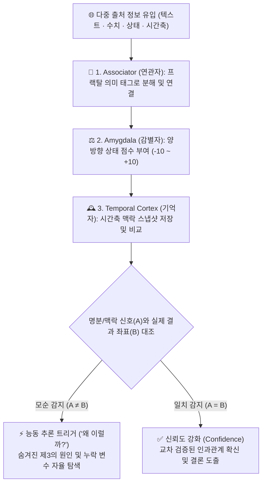

# 🧠 `CKN` 이론 (Contextual Knowledge Network · 의도적 모순 감지 기반 능동 추론 아키텍처)

  <strong>"모순과 일치를 사고의 트리거로 쓴다" : AI가 스스로 '왜?(Why?)'라는 질문을 생성하게 만드는 해마 모사형 범용 인지 컴포넌트 이론</strong> 
  <em>창안 및 설계 (Originated & Architected by): <a href="https://axnli.com">주식회사 에이엑스엔엘아이 (AXNli Inc.)</a> (Systems for Data & AI)</em>

  
  
  
  

---

> 🌐 **For the English edition of this whitepaper, please see [README.md](./README.md).**  
> 🔗 **AXNli 공식 이론 소개 페이지: [https://axnli.com/ckn-theory/](https://axnli.com/ckn-theory/)**

---

## 1. 요약 (Executive Summary)

**CKN (Contextual Knowledge Network)**은 **[주식회사 에이엑스엔엘아이(`AXNli Inc.`)](https://axnli.com)**가 창안한(공식 발표일: 2026년 1월 1일) 범용 인지 컴포넌트(Cognitive Component) 아키텍처입니다.

오늘날 AI 산업이 직면한 핵심 과제는 두 가지입니다:
1. **데이터센터 확장의 한계**: 더 많은 GPU와 막대한 전력 소비
2. **효율적 추론(Efficient Reasoning)**: 제한된 자원과 작은 모델에서도 정확한 맥락을 포착하고 스스로 사고하는 능력

CKN은 후자의 해법으로, **정보(태그) 간의 모순(Contradiction)과 일치(Match)를 자동으로 감지하여 AI가 스스로 `"왜?(Why?)"`라는 질문을 생성하게 만드는 메커니즘**입니다. CKN은 특정 도메인에 종속된 서비스가 아니라, 모든 범용 AI 및 소형 AI(SLM)에 장착할 수 있는 **'사고 부품(Thinking Component)'**입니다.

---

## 2. 핵심 철학: "모순과 일치를 사고의 트리거로 쓴다"

> *"인간이 '왜?'라는 의문으로 시작하여 과학과 기술, 문화를 만들었듯이, AI도 '왜?'라는 자연스러운 의문을 스스로 만들어 발전하는 시대가 옵니다."*

인간 전문가(의사, 과학자, 법률가, 분석가)의 사고 과정을 관찰하면, 모든 데이터가 순조로울 때보다 **서로 다른 정보가 충돌(모순)할 때** 본격적인 추론이 시작됩니다. CKN은 이 과정을 두 가지 신호로 시스템화합니다:

1. **모순 (Contradiction, `A ≠ B`) -> `"왜?"` (Active Reasoning)**
   * 서로 다른 정보가 충돌할 때 이를 단순 오류로 버리지 않고 **'능동적 탐구의 시작점'**으로 삼습니다.
   * *예시*: "성적은 1등인데(`A = +9`), 대학에 떨어졌다(`B = -8`)? 왜 그럴까?" -> 추가 맥락(면접 불참, 지원 자격 미달 등) 자율 재탐색 시작.
2. **일치 (Match, `A = B`) -> `"확신"` (Confidence Reinforcement)**
   * 서로 독립된 정보와 실제 지표가 동일한 방향을 가리킬 때 이를 **'신뢰도 강화'**의 근거로 삼아 확신 있는 결론을 도출합니다.

---

## 3. 기존 RAG(사전 방식)의 한계 vs. CKN(해마 방식)의 접근법

전통적인 RAG(Retrieval-Augmented Generation)는 수동적인 백과사전처럼 작동합니다. 사용자가 모든 맥락을 기억해 완벽한 질문을 던져야만 관련 문서 몇 개를 찾아 나열할 뿐이며, 문서들이 서로 모순될 때는 그대로 프롬프트에 섞어 넣어 환각(Hallucination)을 유발합니다.

| 비교 항목 | 전통적 RAG (백과사전 모델) | **⚡ `CKN` 아키텍처 by AXNli Inc.** |
| :--- | :--- | :--- |
| **작동 비유** | 수동적 사전 검색 | **인간의 해마(Hippocampus): 연관 기억 · 감정/상태 점수화 · 모순 감지** |
| **추론의 시작점** | 사용자가 완벽한 질문을 입력할 때까지 수동 대기 | **사용자가 묻기 전에도 데이터 간 모순을 포착해 스스로 `"왜?"` 질문 생성** |
| **상충 데이터 처리** | 모순된 문서를 무분별하게 나열하여 혼란 가중 | **모순(`A ≠ B`) 자체를 핵심 단서로 삼아 심층 원인 추적** |
| **기억 및 확장 구조** | 고정된 텍스트 청크 + 무거운 GPU 벡터 DB | **거시↔미시 무한 확장 프랙탈 태그(Fractal Tag) + 시간축 스냅샷** |
| **연산 및 토큰 효율** | 수백~수천 토큰의 원문 나열로 높은 비용 소모 | **GPU·벡터 DB 불필요, 에이전트 간 통신 토큰 최대 1/1000 절감** |

---

## 4. 프랙탈 태그(Fractal Tag)와 3대 핵심 인지 모듈

CKN에서 **태그(Tag)**는 세상을 의미 단위로 분해하는 최소 원자입니다. 텍스트, 소리, 이미지, 숫자, 인과관계(`"A는 B의 원인이다"`) 등 어떤 형태든 태그가 될 수 있으며, **자기 유사성(Self-Similarity)을 가진 프랙탈 구조**로 무한히 세분화됩니다:

* **거시 -> 미시**: `글로벌 환경 -> 국가 정책 -> 산업 규제 -> 세부 조항 -> 현장 영향`
* **미시 -> 거시**: `개별 증상 -> 질병군 -> 진료과 -> 의료 체계 -> 공공 보건`

### 인간의 뇌를 모사한 3대 모듈
1. **Associator (연관자)**: 세상의 모든 정보를 의미 단위인 태그로 분해하고 부모·자식 및 원인·결과 관계망으로 연결합니다. 새로운 개념이 등장하면 인간의 개입 없이 스스로 태그 사전을 확장합니다.
2. **Amygdala (감별자)**: 각 태그와 관련된 정보에 양방향 상태 점수(예: `-10` 극도의 부정 ~ `+10` 극도의 긍정, 또는 확률 척도)를 부여하고, 방향성이 없는 98.5%의 중립 노이즈(`0점`)를 과감히 제거해 순도 높은 신호만 남깁니다.
3. **Temporal Cortex (기억자)**: 처리된 맥락을 시간축 스냅샷('맥락의 사진')으로 저장하여 과거 패턴과 현재의 모순 상황을 초고속으로 대조합니다.

---

## 5. 도메인을 가리지 않는 범용 확장성 (Domain-Agnostic)

CKN은 특정 분야의 규칙을 하드코딩하지 않고 추상화된 태그와 상태 좌표의 모순을 계산하므로 모든 전문 분야에 동일하게 적용됩니다:

| 적용 분야 | 태그 구성 예시 | 모순 감지 예시 (`A ≠ B`) | 핵심 가치 |
| :--- | :--- | :--- | :--- |
| **과학 연구·실험** | 실험군, 대조군, 변수, 결과 | "동일 조건인데 상반된 실험 결과 발생" | 숨겨진 제3의 변수 발견 |
| **의료 진단·예후** | 증상, 검사 수치, 병력, 약물 | "일반 검사 수치는 정상인데 비전형적 증상 지속" | 대안 진단 및 정밀 검사 근거 제시 |
| **법률·공공행정** | 판례, 법조항, 사실관계, 시대 맥락 | "유사 사건인데 상반된 판결·처분 도출" | 법리 및 맥락 변화의 핵심 쟁점 파악 |
| **금융·경제 분석** | 뉴스/재무 명분(`A`), 실제 지표 좌표(`B`) | "실적 발표는 호조(`+9`)인데 실제 지표는 급락(`-7`)" | 선반영 여부 및 숨은 악재 자율 추적 |
| **기업 보안·관제** | 인증 로그, 권한, 네트워크 상태 | "정상 승인 계정인데 비정상 대역폭 급증" | 실시간 이상 징후 포착 및 차단 |

---

## 6. 초경량 A2A (Agent-to-Agent) 통신 및 `CKD 이론`과의 결합

### 에이전트 간 '바벨탑' 문제 해결 (토큰 1/1000 절감)
수많은 AI 에이전트가 서로 긴 자연어 문장으로 대화하면 수천 토큰의 비용과 해석의 모호함이 발생합니다. 반면 모든 에이전트가 동일한 CKN 태그 체계(`태그 ID + 상태 점수`)를 공유 온톨로지(Shared Ontology)로 참조하면, **토큰 소비를 1/1000로 줄이면서도 모호함 없는 결정적(Deterministic) 초고속 소통**이 가능해집니다.

### 오픈소스 구현체 및 `CKD 아키텍처`로의 진화
* **오픈소스 패키지 ([`sandclaw-memory`](https://github.com/kokogo100/sandclaw-memory))**: CKN의 핵심인 '자가 성장형 무의존성 태그 사전 RAG'를 누구나 GPU나 벡터 DB 없이 즉시 사용할 수 있도록 파이썬 오픈소스(`pip install sandclaw-memory`)로 공개하고 있습니다.
* **[`CKD 이론 (CKD-Architecture)`](https://github.com/kokogo100/CKD-Architecture)과의 시너지**: **CKN**이 데이터의 모순을 포착해 *"무엇을 왜 파고들어야 하는가"*를 깨우치는 **인지·기억 엔진**이라면, 후속 이론인 **[CKD (물리적 삼권분립 검증 및 폐쇄 루프 지식 증류)](https://github.com/kokogo100/CKD-Architecture)**는 `C(사령탑·심판) · A(구현) · B(팩트 감사)`의 물리적 분리를 통해 그 추론과 실행을 **100% 무결점으로 수렴시키는 검증·실행 엔진**입니다.

---

## 7. 출처 표기 및 라이선스 (Citation & Attribution)

연구, 기술 문서, 또는 제품 개발에서 **`CKN` 아키텍처 이론**을 인용하거나 응용하실 때는 아래와 같이 출처를 명시해 주시기 바랍니다.

* **창안 및 설계 (Originated by)**: **[주식회사 에이엑스엔엘아이 (`AXNli Inc.`)](https://axnli.com)**
* **최초 발표일**: 2026년 1월 1일
* **공식 이론 페이지**: [https://axnli.com/ckn-theory/](https://axnli.com/ckn-theory/)
* **연계 후속 이론**: **[CKD 이론 (`CKD-Architecture`)](https://github.com/kokogo100/CKD-Architecture)** ([https://axnli.com/ckd-theory/](https://axnli.com/ckd-theory/))
* **라이선스**: MIT License (© 2026 AXNli Inc.)
