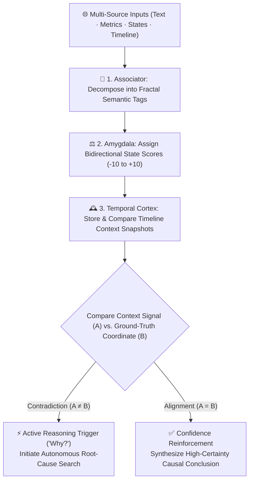

# 🧠 CKN Theory (Contextual Knowledge Network)

<p align="center">
  <strong>Using Contradiction and Alignment as Triggers for Independent AI Reasoning</strong><br>
  <em>A Hippocampus-Inspired Universal Cognitive Component Originated by <a href="https://axnli.com">AXNli Inc.</a> (Systems for Data & AI)</em>
</p>

<p align="center">
  <a href="./README.md"></a>
  <a href="./README.ko.md"></a>
  <a href="https://axnli.com/ckn-theory/"></a>
  <a href="./LICENSE"></a>
</p>

---

> 🇰🇷 **한국어 원문 백서는 [README.ko.md](./README.ko.md)에서 확인하실 수 있습니다.**  
> 🌐 **Official Overview Page: [https://axnli.com/ckn-theory/](https://axnli.com/ckn-theory/)**

---

## 1. Executive Summary

**CKN (Contextual Knowledge Network)** is a cognitive component architecture independently originated by **[AXNli Inc.](https://axnli.com)** in **December 2025** (initial public Git commits: December 18-27, 2025; v2.1 whitepaper edition: January 1, 2026), designed to enable general-purpose AI and compact Small Language Models (SLMs) to reason proactively like human experts.

> 📌 **Prior Art & Cryptographic Git Timestamp Proof (December 2025)**  
> The core concepts of CKN (4-layer hippocampal memory, fractal semantic tag scoring, intentional contradiction `A ≠ B` as an active `"Why?"` reasoning trigger, and ultra-compact A2A ontology communication) were independently designed and publicly committed to GitHub in **December 2025**, prior to subsequent 2026 papers exploring similar themes:
> * **2025-12-18 (`2406e04`)**: [Initial Public Architecture & MCP Commit (`2406e0405f94a1ffdd5e742ecbd525c40293d7ab`)](https://github.com/kokogo100/ragalgo-mcp-server/commit/2406e0405f94a1ffdd5e742ecbd525c40293d7ab)
> * **2025-12-27 (`d8b3544`)**: [Whitepaper v1.0: 4-Layer Memory, Intentional Contradiction (`Algorithm 1`), & A2A Protocol (`d8b3544cc997bc268efcb3de2699c55392c94b43`)](https://github.com/kokogo100/ragalgo-mcp-server/commit/d8b3544cc997bc268efcb3de2699c55392c94b43)
> * **2025-12-29 (`920d104`)**: [Enterprise Whitepaper v2.0 Upgrade (`920d10468509130ff682273d9b38c0b4026c7500`)](https://github.com/kokogo100/ragalgo-mcp-server/commit/920d10468509130ff682273d9b38c0b4026c7500)
> * **2026-01-02 (`f094b17`)**: [CKN Whitepaper v2.1 Global Edition (`f094b17bd308348f3ba2168bd9cdc69aaa31e21e`)](https://github.com/kokogo100/ragalgo-mcp-server/commit/f094b17bd308348f3ba2168bd9cdc69aaa31e21e)

The modern AI industry faces two fundamental challenges:
1. **Datacenter Scaling Bottlenecks**: Ever-larger GPU clusters and unsustainable power consumption.
2. **Efficient Contextual Reasoning**: Delivering high-density, hallucination-free context under strict compute and token limits.

CKN addresses the second challenge at the architectural level: **automatically detecting contradictions (`A ≠ B`) and alignments (`A = B`) across fractal semantic tags so that an AI system generates the question `"Why?"` on its own.** CKN is not a single domain service; it is a universal "thinking component" that can be embedded into any AI agent or local model runtime.

---

## 2. Core Philosophy: "Using Contradiction as a Trigger for Thinking"

> *"Just as humanity built science, technology, and culture by asking 'Why?', AI evolves when it can generate the question 'Why?' on its own."*

Human experts (physicians, scientists, legal analysts, engineers) do not think deeply only when data is uniform; their sharpest reasoning begins when two pieces of evidence **contradict** each other. CKN systematizes this into two primary cognitive signals:



1. **Contradiction (`A ≠ B`) -> `"Why?"` (Active Reasoning)**
   * When conflicting signals arise, CKN treats the discrepancy not as noise or an error, but as the **starting point for autonomous investigation**.
   * *Example*: "Top academic grades (`A = +9`), yet rejected from admission (`B = -8`)? Why?" -> Automatically triggers a targeted search for missing variables (e.g., missed interview, prerequisite gap).
2. **Alignment (`A = B`) -> `"Confidence"` (Confidence Reinforcement)**
   * When independent signals and ground-truth coordinates point in the same direction, CKN reinforces causal confidence and finalizes the conclusion.

---

## 3. Limitations of Traditional RAG vs. The CKN Hippocampus Approach

Traditional RAG (Retrieval-Augmented Generation) acts like a passive dictionary: the user must already know the context, formulate a perfect query, and hope the retrieved text chunks do not contradict one another.

| Dimension | Traditional RAG (Dictionary Model) | **⚡ `CKN` Architecture by AXNli Inc.** |
| :--- | :--- | :--- |
| **Biological Analogy** | Passive encyclopedia lookup | **Human Hippocampus (Associative memory + state scoring + anomaly detection)** |
| **Initiation of Reasoning** | Waits passively until the user asks a complete question | **Proactively detects tag contradictions and generates `"Why?"` queries autonomously** |
| **Handling Conflicting Data** | Dumps conflicting chunks into the prompt, causing hallucinations | **Treats contradiction (`A ≠ B`) as the primary clue for root-cause exploration** |
| **Memory Representation** | Static text chunks + heavy GPU vector embeddings | **Self-growing fractal tag dictionary + temporal snapshots** |
| **Compute & Token Efficiency** | High token overhead (hundreds to thousands of tokens per context) | **Zero GPU / zero vector DB required; reduces A2A token overhead by up to 1/1000** |

---

## 4. Fractal Tag Structure & The Three Core Modules

In CKN, a **Tag** is the atomic semantic unit used to decompose the world. Tags can represent text concepts, numerical states, visual/audio patterns, or causal relations (`"A causes B"`), and they scale infinitely through a **self-similar fractal hierarchy**:

* **Macro -> Micro**: `Global Governance -> National Policy -> Sector Regulation -> Municipal Ordinance -> Clause Impact`
* **Micro -> Macro**: `Single Symptom -> Syndrome Cluster -> Clinical Specialty -> Healthcare System -> Public Health`

### The Three Hippocampal Modules
1. **Associator (Semantic Decomposer)**: Breaks incoming raw data into fractal semantic tags and links parent-child and cause-effect relationships across any domain.
2. **Amygdala (State & Sentiment Evaluator)**: Assigns directional state values (e.g., `-10` to `+10` or `0%` to `100%` probability) to each tag, stripping out neutral noise (`0-score` filtering removes up to 98.5% of raw noise).
3. **Temporal Cortex (Timeline Snapshot Memory)**: Records periodic "photographs of context" along a timeline so the AI can immediately compare past patterns against present anomalies.

---

## 5. Domain-Agnostic Scalability

Because CKN operates on abstract tags and state coordinates rather than hardcoded rules, the exact same engine applies across disciplines:

| Domain | Tag Examples | Contradiction Trigger (`A ≠ B`) | Analytical Value |
| :--- | :--- | :--- | :--- |
| **Scientific R&D** | Experimental group, variable, condition, outcome | "Identical conditions, yet divergent outcomes" | Discovering hidden confounding variables |
| **Medical Diagnosis** | Symptom, lab result, history, medication | "Normal lab markers, yet persistent atypical fever" | Prompting differential diagnosis |
| **Legal & Public Policy** | Precedent, statute, case facts, era context | "Similar factual matrix, yet opposite ruling" | Identifying shifting statutory or contextual factors |
| **Finance & Economics** | News catalyst (`A`), price/flow coordinate (`B`) | "Record earnings news (`+9`), yet sharp sell-off (`-7`)" | Uncovering priced-in expectations or hidden risks |
| **Enterprise Security** | Auth log, privilege level, network flow | "Valid login credential, yet abnormal outbound spike" | Real-time anomaly containment |

---

## 6. Ultra-Compact Agent-to-Agent (A2A) Communication & Synergy with `CKD`

### Breaking the Multi-Agent "Tower of Babel"
When multiple AI agents communicate in verbose natural language, token costs explode and interpretive ambiguity accumulates. By sharing a unified CKN tag ontology (`Tag ID + State Score`), agents exchange deterministic context at **1/1000th the token cost** of natural language.

### Open-Source Implementation & Evolution into `CKD`
* **Open-Source Package ([`sandclaw-memory`](https://github.com/kokogo100/sandclaw-memory))**: The core self-growing, zero-dependency tag-dictionary RAG engine inspired by CKN is available as an open-source Python package (`pip install sandclaw-memory`) requiring no GPU and no vector database.
* **Synergy with [`CKD Theory`](https://github.com/kokogo100/CKD-Architecture)**: While **CKN** provides the cognitive memory and contradiction trigger (*"What anomaly should we investigate and why?"*), **[CKD (Air-Gapped Triadic Verification & Closed-Loop Knowledge Distillation)](https://github.com/kokogo100/CKD-Architecture)** provides the physical separation-of-powers execution and verification loop (`C · A · B`) that guarantees the resulting output is 100% verified.

---

## 7. Citation & Attribution

If you reference **CKN Theory** in research, articles, or software systems, please cite:

```bibtex
@misc{axnli2025ckn,
  title  = {CKN (Contextual Knowledge Network): Using Contradiction and Alignment as Triggers for Independent AI Reasoning},
  author = {AXNli Inc.},
  year   = {2025},
  note   = {First publicly committed December 18-27, 2025 (Git SHA: d8b3544cc997bc268efcb3de2699c55392c94b43); v2.1 edition January 1, 2026},
  url    = {https://axnli.com/ckn-theory/}
}
```

* **Originated by**: **[AXNli Inc. (`주식회사 에이엑스엔엘아이`)](https://axnli.com)**
* **First Public Timestamp**: December 2025 (Git SHA [`d8b3544`](https://github.com/kokogo100/ragalgo-mcp-server/commit/d8b3544cc997bc268efcb3de2699c55392c94b43))
* **Related Architecture**: **[CKD Theory (`CKD-Architecture`)](https://github.com/kokogo100/CKD-Architecture)**
* **License**: MIT License (© 2025-2026 AXNli Inc.)
